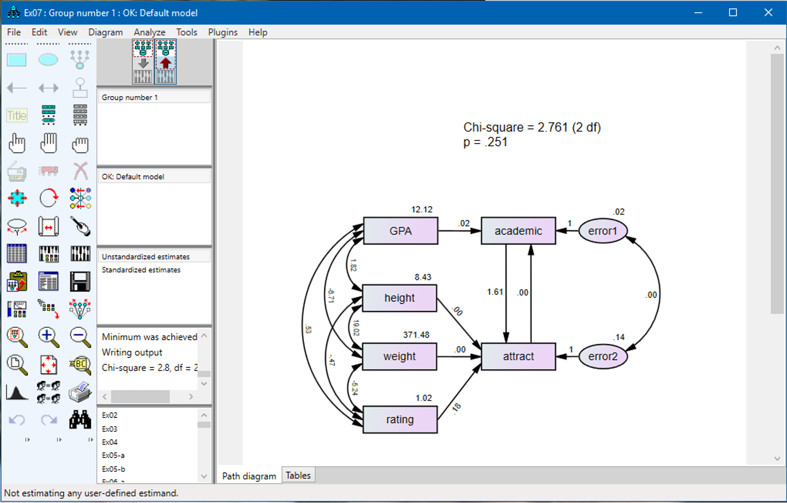
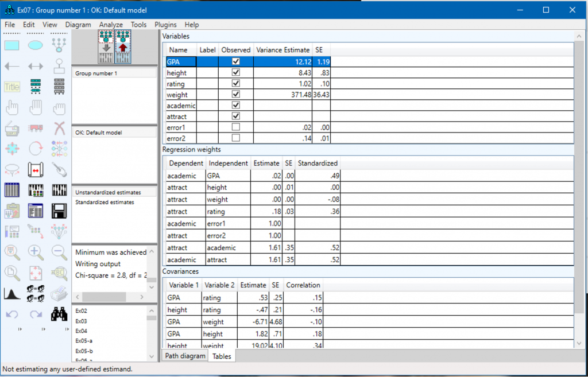
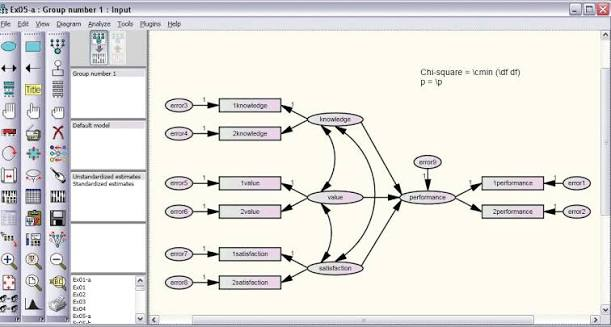

# IBM SPSS Amos From Path Diagrams to Evidence

IBM SPSS Amos lets researchers specify and estimate relationships among observed and latent variables.
Use a path diagram to make the proposed model visible, then retain the data decisions, parameter restrictions, and output needed to assess it.

[](https://ibm-spss-amos.github.io/IBM-SPSS-Amos/)

## Translate the diagram into explicit parameters

An ibm spss amos project begins with relationships that can be stated independently of the drawing.
Identify the observed variables, latent constructs, residual terms, and parameter constraints before interpreting estimated paths.

| Diagram element | Statistical role | Specification detail to record |
| --- | --- | --- |
| Observed-variable rectangle | A measured variable | Exact data-column name |
| Latent-variable ellipse | An unobserved construct | Its indicators and scale |
| Single-headed arrow | A directed model relationship | Whether its coefficient is fixed or estimated |
| Double-headed arrow | A variance or covariance relationship | Which quantities are allowed to covary |
| Residual or disturbance term | Variation outside the stated predictors | Its variance and any justified covariance |

Amos supports [graphical and tabular model specification](https://amosdevelopment.com/features/GraphicalAndNonGraphical/index.html).
Check the parameter meaning behind each visible connection.

A diagram and its executable specification require a translation boundary.
[syntaxbridge.h](SyntaxInterface/syntaxbridge.h) describes analysis and module metadata.
[syntaxbridge.cpp](SyntaxInterface/syntaxbridge.cpp) connects syntax-related work with application components, while [syntaxbridge_interface.h](SyntaxInterface/syntaxbridge_interface.h) declares the exported interface.

Retain the original hypothesized diagram before examining suggested changes.
A revised diagram should have a recorded reason for each added, removed, or constrained path.



## Align the dataset with the measurement model

For spss amos, record which dataset and cases the diagram represents.
Keep variable names, coding direction, measurement scale, and missing-value conventions available beside the model.

Review the input before estimation:

- Confirm that every observed variable maps to the intended column.
- Distinguish variable labels from actual variable names.
- Check whether reverse-scored items have already been recoded.
- Record any case exclusions or group definitions.
- Inspect missingness by variable and by case.
- Identify constant variables and unexpected categories.

The following checks a prepared CSV containing six named indicators.
The file and column names are illustrative; blanks and NA are treated as missing.

```r
responses <- read.csv("responses.csv", na.strings = c("", "NA"))
indicators <- c("item1", "item2", "item3", "item4", "item5", "item6")
stopifnot(all(indicators %in% names(responses)))
selected <- responses[indicators]
print(vapply(selected, is.numeric, logical(1)))
print(colSums(is.na(selected)))
```

This check reports column types and missing-value counts.
Retain the coding decisions that made those columns suitable for the intended analysis.

The declarations in [jasprcpp.h](R-Interface/jasprcpp.h) distinguish requests for full, filtered, and selected data.
[jasprcpp.cpp](R-Interface/jasprcpp.cpp) contains data and callback bridge machinery; [jasprcpp_interface.h](R-Interface/jasprcpp_interface.h) declares its external interface.

That distinction helps frame a reproducibility question: which observations and variables reached the analysis?
Keep the source dataset and the final analysis sample identifiable.

## Establish identification before evaluating fit

An ibm amos model needs enough information and appropriate restrictions to identify its free parameters.
Specify the scale of each latent factor and inspect the model's degrees of freedom.

For a measurement model, consider the indicators, loading constraints, residual variances, and allowed factor covariances together.
A visually tidy diagram can still leave parameters unidentified.

The following compact two-factor illustration uses six variables from an included example dataset.
It fixes the latent-variable scaling through the stated function option.

```r
library(lavaan)
measurement <- '
  factorA =~ x1 + x2 + x3
  factorB =~ x4 + x5 + x6
'
fit_measurement <- cfa(measurement, data = HolzingerSwineford1939, std.lv = TRUE)
summary(fit_measurement, standardized = TRUE, fit.measures = TRUE)
```

The model is an illustration of specification, rather than a recommendation for the dataset.
Inspect the estimates and fit instead of assuming the chosen factor structure is supported.

Amos can display estimates directly on the model diagram.
Keep standardized and unstandardized estimates distinguishable when presenting that output.

A fixed loading and a fixed latent variance define different scaling conventions.
When comparing software results, align the scaling choices before comparing coefficients.

## Read estimation status before substantive conclusions

For spss amos software, preserve the estimator, missing-data method, sample size, and model restrictions with the results.
Check that estimation completed and inspect warnings or improper estimates before interpreting paths.

Amos documents [full-information treatment of missing data](https://amosdevelopment.com/features/missing_data/index.html).
Choose the approach for its assumptions and the analysis context, then report that choice.

Use several parts of the output together:

1. Estimation status and any warnings.
2. Parameter estimates, standard errors, and uncertainty intervals.
3. Residual variances and other admissibility checks.
4. Overall fit measures and relevant residual information.
5. Theoretical and practical interpretation of the estimated relationships.

A convergence message and substantive model adequacy are different observations.
An estimate that contradicts a variance constraint deserves investigation even when other output looks plausible.

The computation-process entry point appears in [main.cpp](Engine/main.cpp).
[engine.h](Engine/engine.h) declares the engine and message-handling interface, and [engine.cpp](Engine/engine.cpp) contains its implementation.

The Windows manifest [JASPEngine.exe.manifest](Engine/JASPEngine.exe.manifest) requests a UTF-8 active code page for that executable.
Keep text encoding and the data-transfer environment distinguishable from statistical model assumptions.



## Interpret indirect effects with their uncertainty

For sem spss amos work, state which relationship is direct, which is mediated, and how the total effect is defined.
A path diagram alone does not establish the causal assumptions needed for a causal interpretation.

Amos supports [user-defined estimands](https://amosdevelopment.com/features/user-defined/index.html) and [bootstrap uncertainty calculations](https://amosdevelopment.com/features/bootstrap/index.html).
Keep the effect definition and interval method with the reported result.

This illustration expects a separate CSV with numeric predictor, mediator, and outcome columns.
It defines the indirect and total effects explicitly.

```r
effect_model <- '
  mediator ~ a*predictor
  outcome ~ b*mediator + cp*predictor
  indirect := a*b
  total := cp + a*b
'
fit_effects <- lavaan::sem(effect_model, data = read.csv("mediation.csv"),
                          se = "bootstrap", bootstrap = 1000)
lavaan::parameterEstimates(fit_effects, ci = TRUE)
```

The resampling count is illustrative.
Review the interval construction, sampling assumptions, and numerical stability for the actual study.

Report the effect estimate with its uncertainty rather than treating the sign of one coefficient as the entire result.
Keep the measurement model and the assumed ordering of variables attached to the interpretation.

## Compare restrictions and groups deliberately

Amos supports fitting restricted models and analyzing multiple populations.
Document what changes between two models before comparing their results.

For a nested comparison, identify the added equality constraints or other restrictions.
Keep the data, estimation conventions, and relevant analysis settings aligned.

For group comparisons, examine whether the measurement relationships support the intended comparison.
Equal factor loadings and equal indicator intercepts impose different restrictions.

The [multiple-group illustration](https://lavaan.ugent.be/tutorial/groups.html) shows how these constraint sets can be distinguished.
Record the actual constraints used in Amos rather than relying on a short model label.



Keep exploratory modifications separate from the model specified before looking at the results.
A modification prompted by the current dataset needs an explicit rationale and, where possible, assessment with additional data.

## Preserve the analysis environment with the model

Retain the diagram, dataset reference, estimator settings, output, and a record of model revisions.
For Amos, include the installed version and any plug-ins required to reproduce the analysis.

The configuration references illustrate why application and analysis environments need separate records:

- [modules-settings.json](Modules/modules-settings.json) lists configured analysis modules.
- [remote-bundles.json](Modules/remote-bundles.json) records platform-specific module bundle sources and checksums.
- [install-modules.R.in](Modules/install-modules.R.in) is a template for obtaining and installing module bundles.
- [install-renv.R.in](Modules/install-renv.R.in) prepares the package-environment tooling.
- [install-tools.R.in](Modules/install-tools.R.in) restores tools including Rcpp and RInside.

These templates contain configuration placeholders and are reference material for environment reconstruction.
Record the resolved package versions and platform when documenting an environment.

For a reviewable result, keep a concise interpretation beside the numerical output.
State which hypotheses the fitted model addresses, what the diagnostics leave uncertain, and which conclusions depend on additional assumptions.

## Example and source scope

The code examples use R; the fitted-model examples use lavaan, documented in its [CFA tutorial](https://lavaan.ugent.be/tutorial/cfa.html) and [mediation tutorial](https://lavaan.ugent.be/tutorial/mediation.html).
All 15 linked local files are JASP infrastructure references, not Amos source code or implementations of the statistical models discussed here.
The supplied snapshot omits the complete application and analysis modules; its files illustrate software boundaries and environment management rather than Amos internals.

## Related Search Terms

ibm spss amos, spss amos, ibm amos, spss amos software, sem spss amos, structural-equation-modeling, path-analysis, factor-analysis, latent-variables, statistical-modeling, multivariate-analysis, missing-data, statistics, psychometrics, research
